<p align="center">
  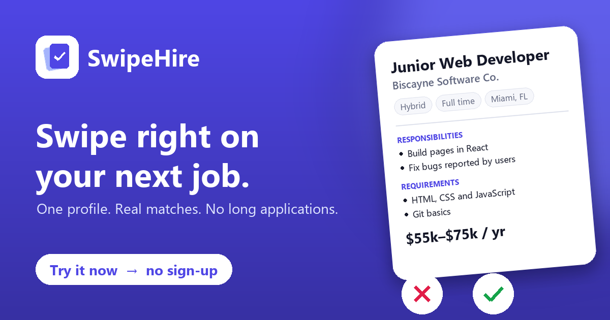
</p>

<h1 align="center">SwipeHire</h1>

<p align="center">
  <b>Tinder for jobs.</b> Job seekers swipe on jobs, employers swipe on applicants,<br>
  and when both swipe right it's a match.
</p>

<p align="center">
  <a href="https://swipehire.whalenet.net/try"><b>▶ Try it as a job seeker</b></a> &nbsp;·&nbsp;
  <a href="https://swipehire.whalenet.net/try/employer"><b>▶ Try it as an employer</b></a>
  <br><sub>No sign-up. Each link gives you your own throwaway test account.</sub>
</p>

<p align="center">
  
  
  
  
</p>

---

**Group 15, FIU group project.**
Team: Chantal Silva, Andrew Whalen, Lucas Porfirio, Caleb Holness, Frank Hernandez.

## Contents

- [The idea](#the-idea)
- [How it works](#how-it-works)
- [Job seeker screens](#job-seeker-screens)
- [Employer screens](#employer-screens)
- [Admin dashboard](#admin-dashboard)
- [The recommendation algorithm](#the-recommendation-algorithm)
- [How it's built](#how-its-built)
- [Run it yourself](#run-it-yourself)
- [What's next](#whats-next)

## The idea

Applying for jobs is slow. You fill in the same form over and over and usually never
hear back. SwipeHire fixes that in two ways:

1. **One profile, many jobs.** You fill out your profile once. Swiping right on a job
   sends that profile to the employer. Nothing else to fill in.
2. **Employers only see people who want the job.** An employer's applicant list only
   has seekers who already swiped right on one of their jobs. When the employer
   swipes right too, it's a **match** and both sides can see each other's contact info.

The design follows our Part 1 document and three paper sketches: **Homepage**, **Profile** and **Matches**.

## How it works

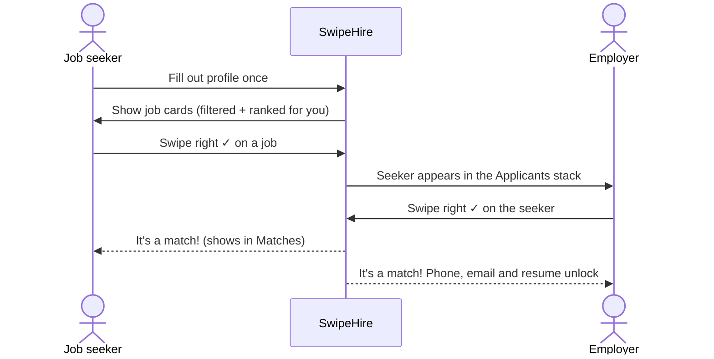

A swipe left (✕) means "pass". The card goes away, and the other side never finds out.

| | Swipe left ✕ | Swipe right ✓ |
|---|---|---|
| **Job seeker on a job** | Pass, never see it again | Send my profile to this employer |
| **Employer on an applicant** | Pass | **Match**, and contact info unlocks for both sides |

You can drag the card with your finger or mouse, tap the ✕ / ✓ buttons, or use the ← / → keys.

## Job seeker screens

<table>
  <tr>
    <td align="center" width="25%">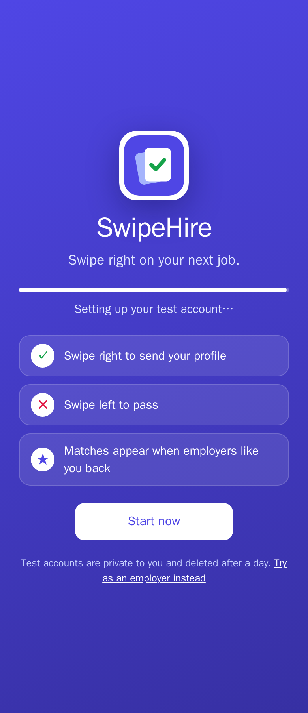<br><b>1. Open the link</b><br><sub>The share link shows a splash page and then logs you into a fresh test account.</sub></td>
    <td align="center" width="25%">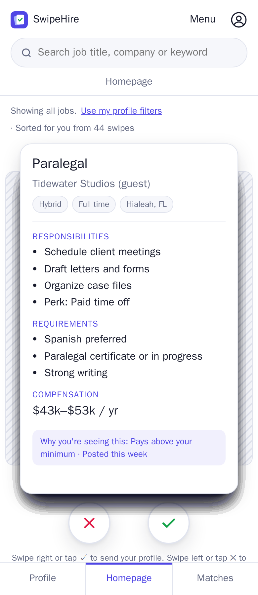<br><b>2. Homepage</b><br><sub>One job card at a time: title, company, responsibilities, requirements and pay.</sub></td>
    <td align="center" width="25%">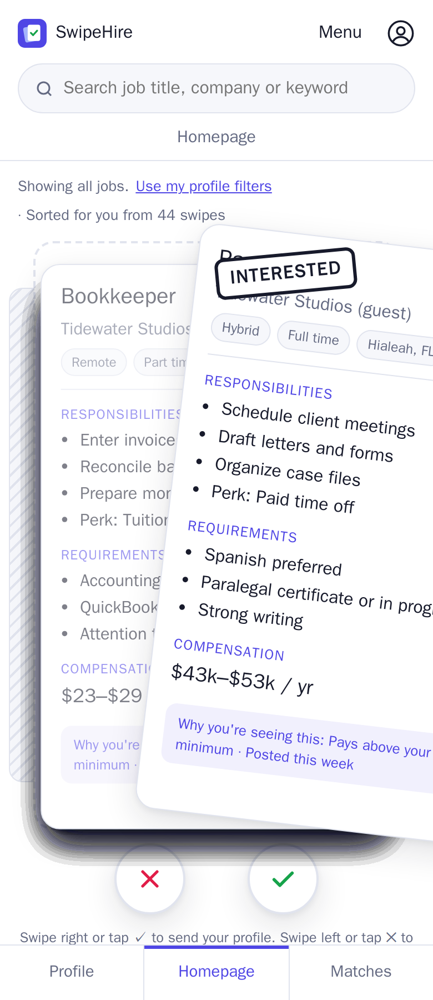<br><b>3. Swipe</b><br><sub>Drag right and the card is stamped <i>INTERESTED</i>. Your profile goes to the employer.</sub></td>
    <td align="center" width="25%">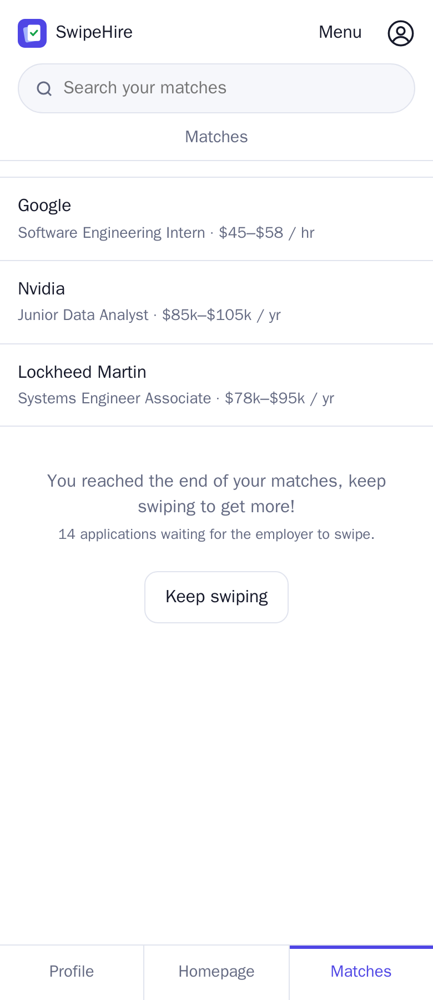<br><b>4. Matches</b><br><sub>Employers who liked you back. Also shows how many applications are still waiting.</sub></td>
  </tr>
</table>

<table>
  <tr>
    <td align="center" width="25%">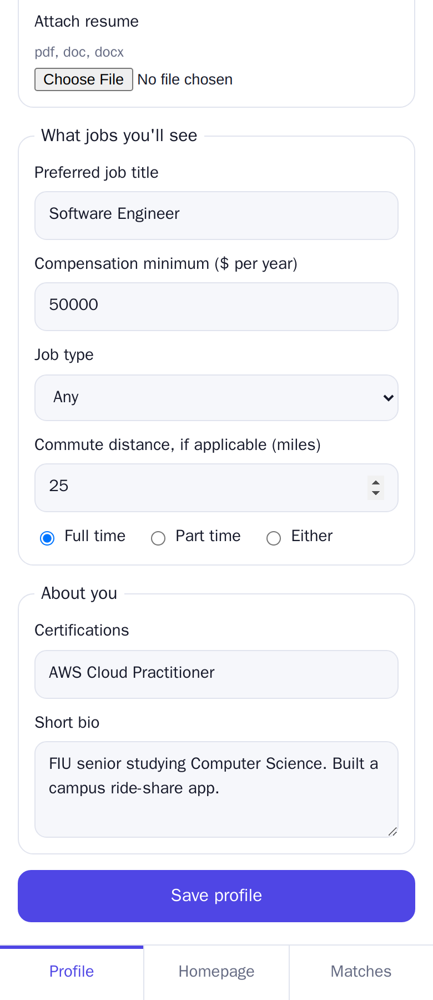</td>
    <td>
      <b>Profile</b><br>
      Contact info, resume upload, and settings for <i>"What jobs you'll see"</i>:
      preferred job title, minimum pay, remote / hybrid / in person, commute distance,
      and full or part time.
      <br><br>
      These settings <b>filter</b> the Homepage. Jobs that pay less than your minimum
      don't show up. Hourly pay is converted to yearly pay (× 2080 hours) so the two can be compared.
      They also feed the <a href="#the-recommendation-algorithm">recommendation algorithm</a>.
      The "Why you're seeing this" note at the bottom of each card says which ones mattered.
      <br><br>
      Out of cards? The Homepage offers to bring back jobs you passed on, or to show every job and ignore your filters.
    </td>
  </tr>
</table>

## Employer screens

<table>
  <tr>
    <td align="center" width="33%">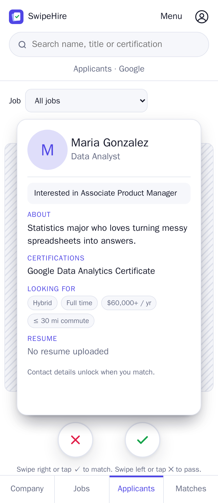<br><b>Applicants</b><br><sub>Only people who swiped right on your jobs. Phone and email stay hidden until you match.</sub></td>
    <td align="center" width="33%">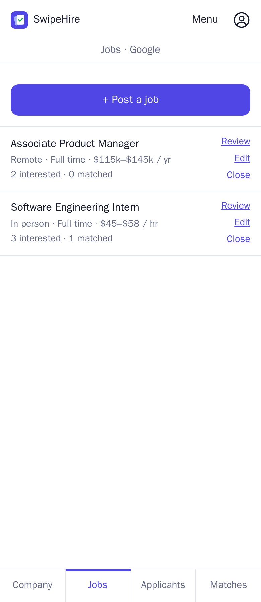<br><b>Jobs</b><br><sub>Post, edit and close jobs. Shows how many people are interested and how many matched.</sub></td>
    <td align="center" width="33%">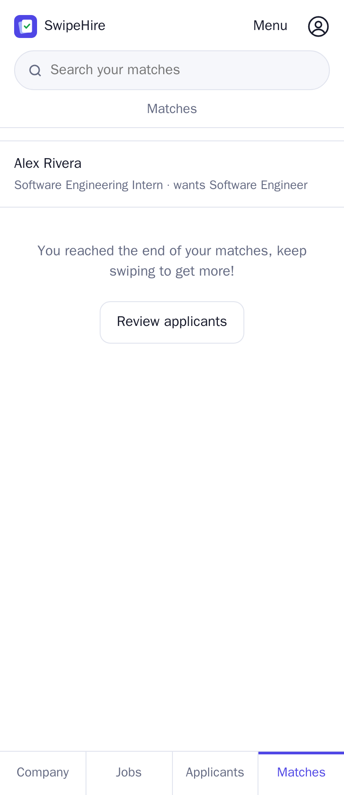<br><b>Matches</b><br><sub>Applicants you matched with. Their full contact info and resume are now visible.</sub></td>
  </tr>
</table>

## Admin dashboard

An `admin` account gets a read-only dashboard with live numbers from the database:
users, open jobs, swipes per day, match rate, most-liked jobs, the companies with the most matches,
and a recent activity feed. Separate tabs list all users and all jobs.

<p align="center">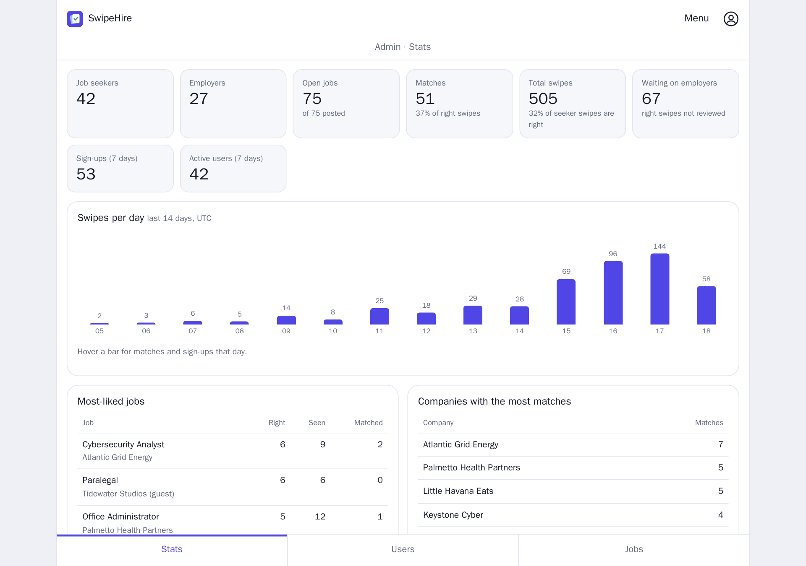</p>

## The recommendation algorithm

The Homepage doesn't just list jobs newest first. First the profile filters decide which jobs
*can* show, then every remaining job gets a score and the best ones come first
([`views/recommend.py`](views/recommend.py)):

| Part | What adds points |
|---|---|
| **Profile fit** | Job title shares words with your preferred title (up to +3), matches your job type (+1) and schedule (+0.5), pays more than your minimum (+0.5) |
| **Learned taste** | Every past swipe teaches it. Swipe right = +1 and swipe left = −0.6 for that job's title words, company, job type, schedule, pay band and city. Newer swipes count more. |
| **Freshness** | Posted in the last 7 days: +0.3 |

So if you keep swiping right on design jobs, Graphic Designer and UX jobs move to the
top the next time you load the page, even if your profile says "Software Engineer".

## How it's built

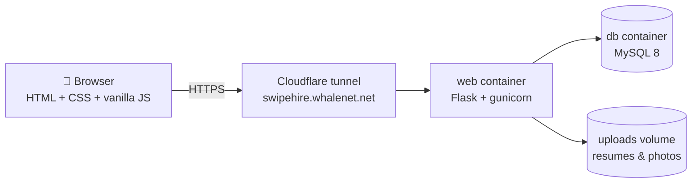

- **Backend:** Python 3.12, Flask 3, gunicorn
- **Database:** MySQL 8.0. The tables are users, seeker profiles, companies, jobs, seeker swipes and employer swipes.
  There's no "matches" table. A match is just a query that finds a seeker swipe and an employer swipe that both say yes.
- **Frontend:** Jinja templates, one CSS file and one small JavaScript file for the swipe gesture.
  No frameworks and no build step. Mobile-first: on a computer it shows as a phone-width column.
- **Security basics:** hashed passwords, CSRF tokens on every form, role checks on every page,
  and resumes are only visible to the owner and to employers they applied to.
- **Docker:** two containers, both with health checks. `docker compose up` sets up the tables and adds demo data the first time.

```
main.py            App setup, CSRF check, /try share links, /health
views/             One file per area: auth, seeker, employer, admin, recommend, guests, files
templates/         Pages (seeker/, employer/, admin/) + shared layout
static/            style.css, app.js (swipe logic), logo and preview images
sql/schema.sql     Database tables
init_db.py         Creates tables and seeds demo data on startup
fake_jobs.py       Generates fake companies, jobs and seekers for testing
```

## Run it yourself

You need [Docker Desktop](https://www.docker.com/products/docker-desktop/).

```bash
cp .env.example .env
```

```bash
docker compose up --build -d
```

Then open **http://localhost:8300**.

The first start adds demo data: 72 jobs, 26 employers, 35 seekers and about 400 swipes.
The demo accounts below use the password from `DEMO_PASSWORD` in `.env` (default `swipehire`):

| Email | What you'll see |
|---|---|
| `seeker@swipehire.test` | Job seeker Alex Rivera, already matched with Google, Nvidia and Lockheed Martin |
| `google@swipehire.test` | Employer with applicants waiting |
| `admin@swipehire.test` | Admin dashboard |

Or click **Guest job seeker** / **Guest employer** on the login page. Every click makes a new
account, so many people can test at the same time. Guest accounts delete themselves after 24 hours.

Developer details are in **[AGENTS.md](AGENTS.md)**: every command, the data model, conventions and gotchas.

## What's next

- Rank the employer's applicant stack by fit, not just oldest first
- A real distance filter (job locations with coordinates)
- An "Undo last swipe" button
- Messaging between matched seekers and employers
- Notifications when you get a new match
- Password reset and email verification
- Automated tests
